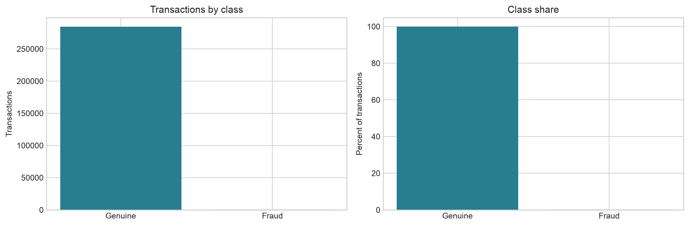
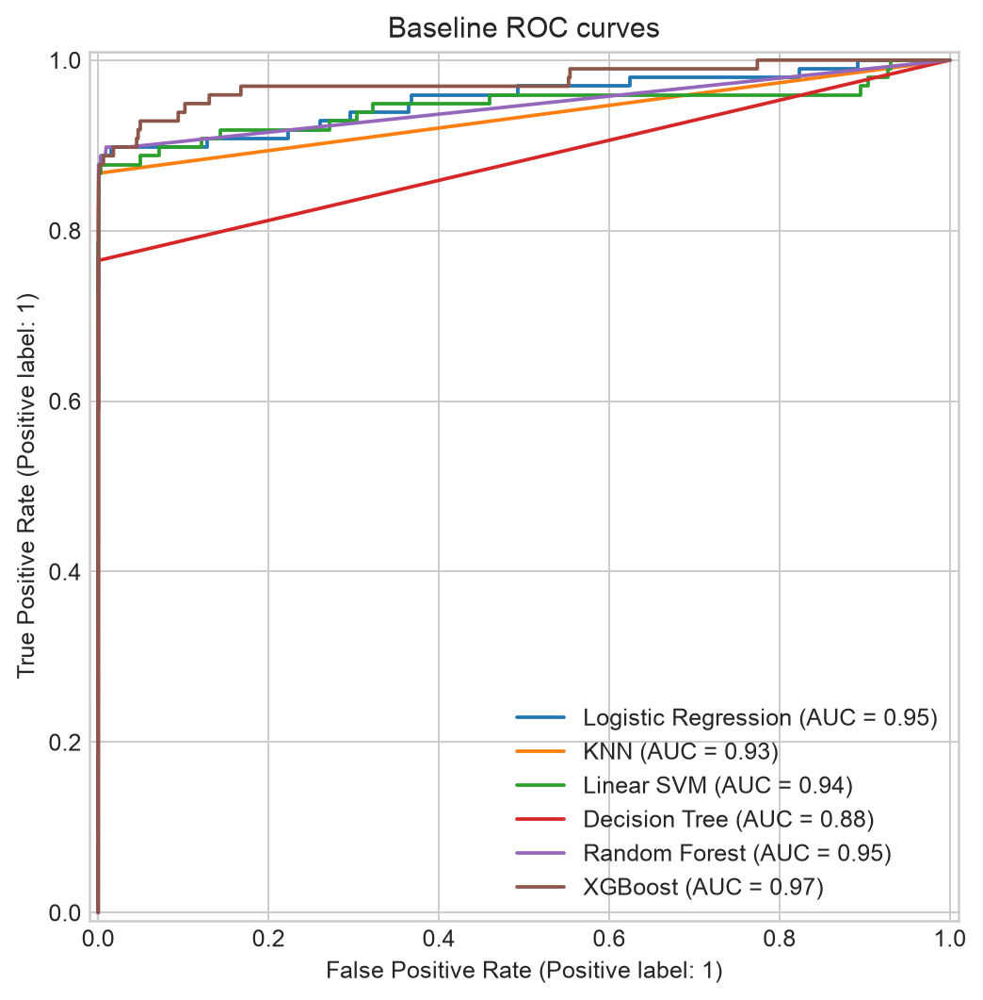
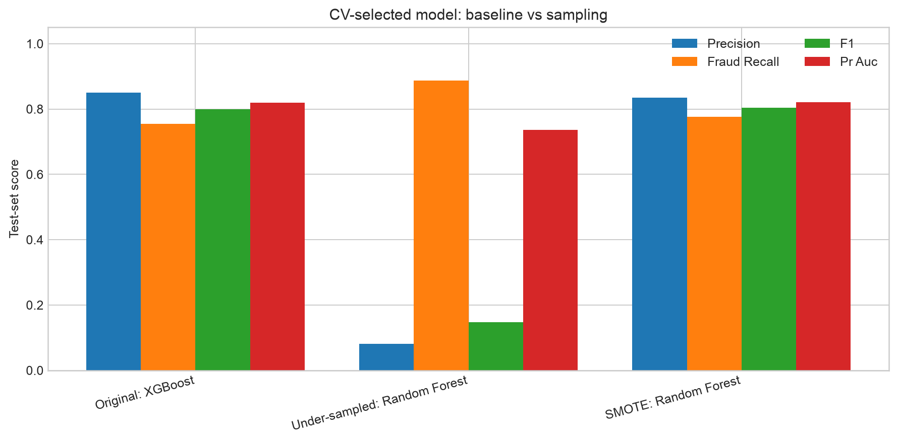
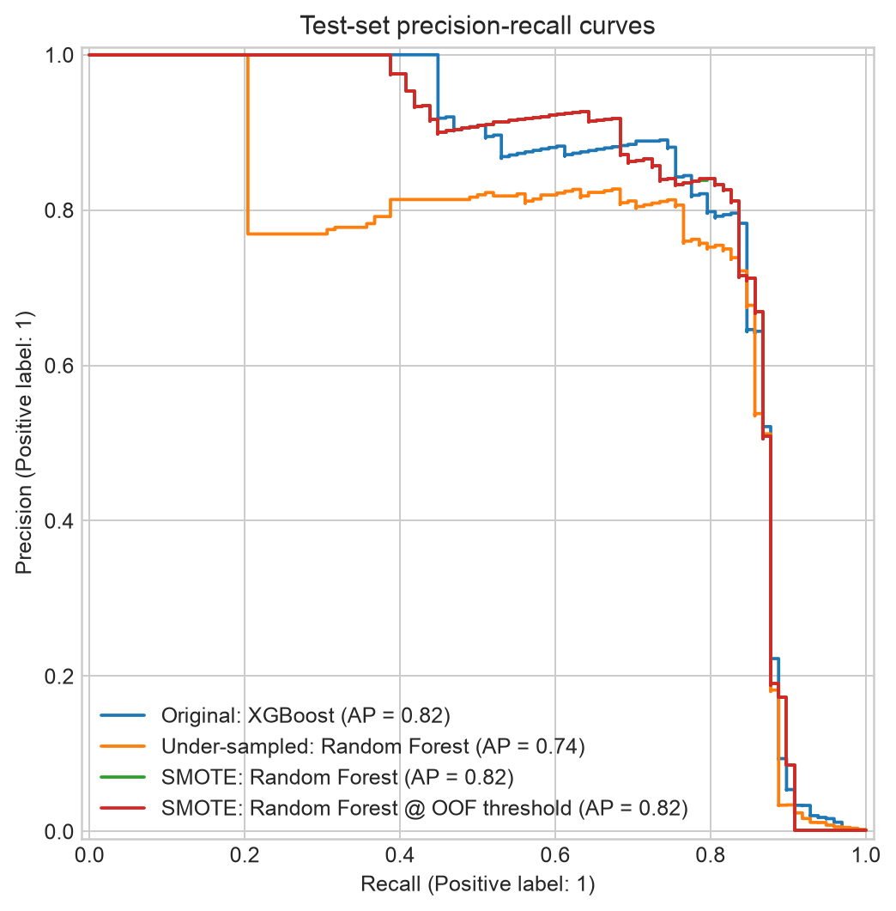
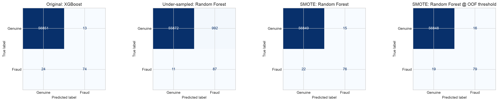

# Credit Card Transaction Analytics & Fraud Detection

A reproducible machine-learning study of highly imbalanced credit-card transactions. It compares six classifiers on the original class distribution, then evaluates random under-sampling, SMOTE, compact hyperparameter searches, and a training-only operating-threshold selection. Final measurements use the same untouched, naturally imbalanced test set.

## Problem
Only a tiny fraction of card transactions are fraudulent. Missing fraud can create direct losses, while overly aggressive detection creates costly false alarms and unnecessary card declines. Accuracy alone hides this trade-off because an always-genuine classifier can score highly on an imbalanced dataset.

## Dataset
The data represents 284,807 transactions from European cardholders over two days in September 2013, with 492 frauds. `V1` through `V28` are anonymized PCA components; `Time` is elapsed seconds and `Amount` is the transaction amount. The source is the Worldline and Université Libre de Bruxelles Machine Learning Group collaboration.

Download `creditcard.csv` from the [Kaggle Credit Card Fraud Detection dataset](https://www.kaggle.com/datasets/mlg-ulb/creditcardfraud) . The notebook also accepts `data/creditcard.csv`. Please cite the source research listed on the dataset page, including Dal Pozzolo et al., *Calibrating Probability with Undersampling for Unbalanced Classification* (CIDM, 2015).

## Workflow
1. Notebook 1 inspects the data, plots class and transaction distributions, and trains Logistic Regression, KNN, Linear SVM, Decision Tree, Random Forest, and XGBoost on original-imbalance training data.
2. Notebook 2 repeats the same seed (`42`), stratified split, and 30,000-row stratified training subset. It compares original training, random under-sampling, and SMOTE using stratified five-fold average-precision grid search.
3. Preprocessing and sampling are inside `imblearn` pipelines. Sampling occurs only within each training fold; the full test split remains untouched and naturally imbalanced.
4. The logistic threshold analysis and final selected-model threshold are chosen from out-of-fold training predictions, not from test performance.
5. Results and plots are written to `results/` and `images/` when notebooks execute.

The stratified 30,000-row training subset is used to keep KNN, SMOTE, and the 5-fold searches manageable on a typical laptop. Final scoring is performed on all 56,962 observations of the 20% test split (98 frauds).

## Measured Test Results
The table reports each strategy's model selected by mean five-fold average precision, plus the same SMOTE model with its OOF-selected threshold. Threshold for the first three rows is the estimator's default decision rule.

| Strategy / model | Accuracy | Precision | Fraud recall | F1 | ROC-AUC | PR-AUC |
|---|---:|---:|---:|---:|---:|---:|
| Original: XGBoost | 0.9994 | 0.8506 | 0.7551 | 0.8000 | 0.9743 | 0.8186 |
| Under-sampled: Random Forest | 0.9824 | 0.0807 | 0.8878 | 0.1480 | 0.9749 | 0.7368 |
| SMOTE: Random Forest | 0.9994 | 0.8352 | 0.7755 | 0.8042 | 0.9512 | 0.8210 |
| SMOTE: Random Forest, OOF threshold 0.4413 | 0.9994 | 0.8316 | 0.8061 | 0.8187 | 0.9512 | 0.8210 |

The best CV-selected model is SMOTE + Random Forest (mean CV PR-AUC `0.8663`). At the default decision rule it finds 76 of 98 frauds, with 15 false positives. The threshold selected using out-of-fold training F1 improves detection to 79 of 98 frauds while generating 16 false positives. Under-sampling finds 87 frauds but generates 992 false positives and loses overall accuracy; this illustrates the information-loss and alert-volume trade-off. Model choice depends on the costs and review capacity of the deployment setting.











## Setup and Run
Use Python 3.11 or newer. From this directory:

```bash
python -m venv .venv
source .venv/bin/activate  # Windows: .venv\\Scripts\\activate
python -m pip install -r requirements.txt
jupyter notebook notebooks/01_eda_and_baseline_models.ipynb
jupyter notebook notebooks/02_imbalance_handling_and_model_comparison.ipynb
```

Place the CSV at the project root, its parent, or `data/creditcard.csv` before running. Run each notebook from top to bottom. Notebook 2 repeats its own deterministic data split and does not require Notebook 1's kernel state.

## Reproducibility and Limitations
The notebooks use seed `42` for splitting, estimators, sampling, and shuffled stratified folds. Dependencies are pinned in `requirements.txt`. The supplied dataset spans only two days and contains anonymized features; results do not establish performance under temporal drift, changing fraud strategies, production-scale alert constraints, or data from other issuers. The random stratified split may place temporally related transactions in both partitions. Future work should use time-based evaluation, probability calibration after resampling, cost-sensitive objectives, operational alert-budget analysis, and drift monitoring.

## License and Attribution
The notebooks, documentation, and project-specific code are released under the MIT License in `LICENSE`. The dataset is not included and is governed by its source's separate terms and ODbL 1.0 database license. Dataset attribution: Worldline and the Machine Learning Group, Université Libre de Bruxelles (ULB); see the [dataset source](https://www.kaggle.com/datasets/mlg-ulb/creditcardfraud) for citation details.
